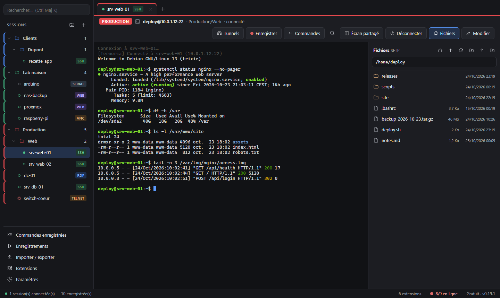
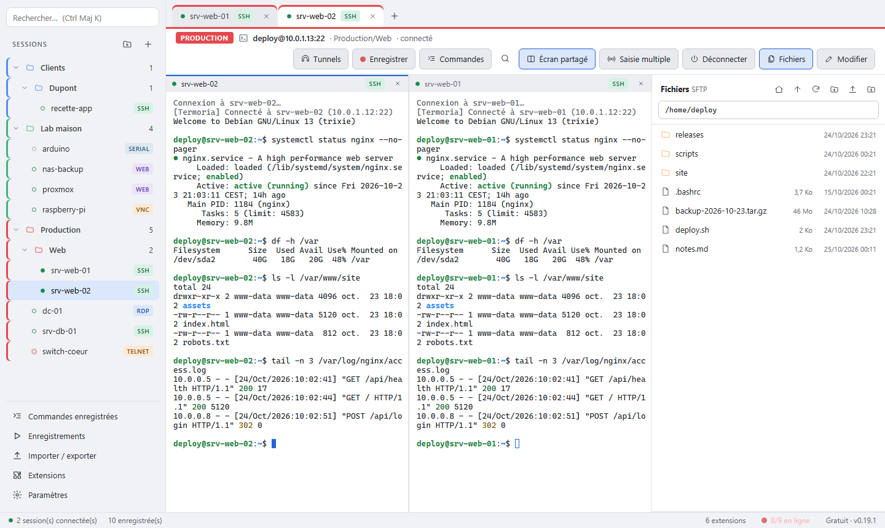

# Portunia

**English** · [Français](README.fr.md)

**All your remote connections in one window, for Windows.**
SSH, Remote Desktop (RDP), VNC, Telnet, FTP, serial port, local shells and web consoles: a lightweight app (installer under 10 MB), fast and built for administrators' day-to-day work.

> Portunia was called **Termoria** until version 0.39. A Termoria install moves to Portunia through the automatic update and keeps its sessions, vault and settings.

## Download

➡️ **[Latest version](https://github.com/jpiperault/Portunia-releases/releases/latest)**: download `Portunia_x.y.z_x64-setup.exe` and run it.

- Installs for the current user, **no administrator rights needed**.
- Windows 10 and 11 (64-bit).
- Portunia **then updates itself**: a banner offers each new version, nothing is installed without your consent.

## What Portunia does

**Connections**
- **SSH** compatible with OpenSSH 10: private key (PuTTY `.ppk` keys included), password or agent (Pageant / OpenSSH), chained jump hosts, compatibility mode for older equipment.
- **Remote Desktop (RDP)** in a tab, with shared clipboard and a screen fitted to the window, or in the Windows client if you prefer.
- **VNC**, **Telnet**, **serial port** (COM ports detected automatically), **FTP / FTPS** and **web consoles**.
- **Local shells**: PowerShell, Command Prompt, WSL distributions, Git Bash.
- **Quick connect**: type `ssh deploy@10.0.1.12`, `rdp srv-01` or just an address, without creating a session.

**Day to day**
- **SFTP file browser** next to the terminal: drag and drop files and whole folders, edit a remote file in your usual editor with automatic upload.
- **Split screen** with up to 4 sessions, and **multi-input** to type the same command on several servers.
- **Saved commands** (Ctrl+Shift+P), **SSH tunnels** (local port, SOCKS proxy, remote port), **X11**, **automatic reconnection**.
- **Notes per session** in Markdown, **shared credentials** across sessions, **network tools** (ping, traceroute, port test, DNS, Wake-on-LAN).
- **Monitoring**: green or red dot and latency for each server.
- **Folders and sub-folders**, **colours per folder** (spot production at a glance), light or dark theme, 9 terminal palettes.
- **Import** from `~/.ssh/config`, PuTTY and mRemoteNG.

**Heimdia bastion**
Portunia connects to the [Heimdia](https://github.com/jpiperault/Heimdia-releases) bastion: access control, two-factor sign-in, server accounts kept in a vault, recorded SSH and Remote Desktop sessions, video-like replay and a tamper-evident audit log. Allowed servers appear in the sidebar and open with one click.

**Security**
- Passwords stored in the **Windows Credential Manager**, never in clear text on disk; data encrypted as soon as a master password is set.
- **Lock** with a master password or **Windows Hello**, at startup and after inactivity.
- SSH server keys checked: a changed key blocks the connection.
- **Signed** updates.

## Editions

Portunia is **free for personal use**, with every protocol.

- **Pro**: session recording, server dashboard, command on several servers, Docker and Kubernetes containers, monitoring alerts, S3 storage.
- **Teams**: administration and audit of the Heimdia bastion from Portunia (session replay, audit log, web portal).

During the preview, every feature is unlocked.

## Reporting a problem

Open an [issue](https://github.com/jpiperault/Portunia-releases/issues) describing what you were doing, the message shown and the Portunia version (bottom right of the window).

---

© Portunia. All rights reserved. Portunia relies on open-source software (Tauri, russh, IronRDP, xterm.js, vnc-rs…), under MIT and Apache 2.0 licences.
